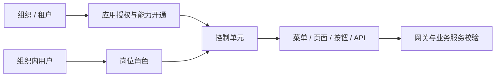
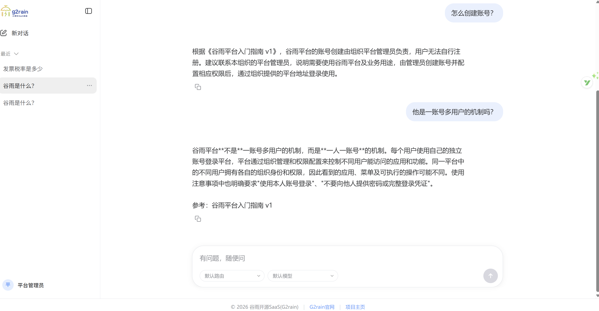

  

# G2rain（谷雨）开源智能体平台

**面向企业的开源智能体平台，连接模型、知识与业务工具，让智能体在明确的身份和权限边界内执行任务。**

G2rain（谷雨）面向希望将 AI 接入实际业务的开发者与企业团队，将 SaaS基座、知识库、智能体与业务应用组织在同一平台体系中。你可以从知识对话开始体验，也可以部署现有平台能力，使用前后端工具链开发自己的业务应用。

**当前已具备应用开发与部署能力：基础搭建、SaaS基座现有能力、知识库已可用；智能体平台与智能客服已开发完成，待开放；交易开通、计量计费等商业化能力处于规划设计中。**

**私有部署已可用。** 企业可以在自己的环境中部署现有 SaaS基座、知识库及业务应用，开展应用开发与使用。交易、订阅、计量计费等商业化规划服务于云端运营，不是私有部署的前置条件。智能体平台与智能客服已开发完成，待开放，具体接入方式请与维护者交流。

**[立即体验](#在线演示)** · [项目介绍与引用资料](docs/project-introduction.md) · **[探索项目](#探索项目)** · [查看界面](#看看谷雨如何连接知识与业务) · [平台文档](docs/index.md) · [官方网站](https://www.g2rain.com) · [参与贡献](#社区参与)

如果你关注这个方向，欢迎 **[Star 主仓库](https://github.com/g2rain/g2rain)** 收藏组织总入口，并到 **[组织主页](https://github.com/g2rain)** 点击 **Follow**，关注后续动态。

## 在线演示

- [知识对话演示](https://demo.g2rain.com/chat/?entry=ek_xV3IEOTK8HfexoR3PupYcF)：体验知识对话入口，无需登录。
- [主应用演示](https://demo.g2rain.com/main/)：体验平台主应用入口，用户名和密码均为 `admin`。

接入交流请[联系维护者](https://www.g2rain.com/platform/contact.html)。

智能体平台与智能客服已开发完成，正式开放安排另行说明。

## 为什么关注 G2rain

- **让知识进入业务**：维护文件、FAQ 和知识版本，通过审核发布、检索与回答接口连接内容运营和日常使用。
- **让应用具备企业使用基础**：复用组织租户、统一登录、应用授权和岗位资源权限，支撑多个业务应用协作。
- **让团队更快开始开发**：通过前端脚手架、主子应用模板、后端工程与代码生成器，复用组件和工程约定。
- **从部署到持续演进**：部署编排连接基础设施、平台服务与前端应用，再围绕智能体和智能客服扩展场景。

## 现在可以从哪里开始

| 你的目标 | 建议路径 | 当前状态 |
| --- | --- | --- |
| 先看看知识对话和平台界面 | [在线演示](#在线演示) → [界面展示](docs/showcase.md) | 演示可体验 |
| 部署知识库或搭建业务应用环境 | [开发与部署入口](docs/getting-started.md) → [g2rain-deploy](https://github.com/g2rain/g2rain-deploy) | 基础、现有 SaaS基座与知识库已可用 |
| 开发自己的前后端应用 | [前端工具链](docs/releases/ecosystem-v2026.10.29.md) · [后端工具链](docs/releases/backend-ecosystem-v2026.10.30.md) | 组件、模板与工具已有版本发布 |
| 接入智能体或智能客服 | [能力与路线图](docs/roadmap.md) → [联系维护者](https://www.g2rain.com/platform/contact.html) | 已开发完成，待开放 |

平台采用 **Java 微服务 + Vue 3 微前端**。企业权限、知识运营和研发工具共同支撑应用接入；交易支付、商业订阅和计量计费见[商业化规划](docs/roadmap.md#六商业化)。

## 企业级权限管控

从租户能力开通到岗位功能授权，G2rain 使用组织、应用授权、角色、控制域、控制单元与资源关系组织权限；IAM、Gateway 和领域服务分别承担身份认证、接口入口校验与业务数据授权职责。

这张图概括能力开通与岗位授权两条关系，实际访问还需满足激活状态、主体类型与数据归属等条件。完整[领域对象关系图与请求校验图](docs/permission-model.md#权限领域对象如何关联)保留在专题文档中。

## 看看谷雨如何连接知识与业务

**从业务知识出发，用对话获得参考，让执行过程可以查看。** 下面展示围绕平台入门指南连续提问的界面，回答中显示知识参考来源。

| 场景 | 展示重点 |
| --- | --- |
| 知识管理 | 版本、发布状态、标签与源文件，连接内容维护和审核流程 |
| 对话问答 | 围绕业务问题提问，结合知识参考进一步核对答案 |
| 执行追踪 | 查看请求到结果的路径、调用情况与任务详情 |

[查看全部三张界面与场景说明](docs/showcase.md)。截图由项目维护者提供，各图为独立示例；实际运行与集成状态见[项目进展](docs/roadmap.md)。

## 探索项目

主仓库连接平台架构、基础服务、应用、工具与社区。你可以按兴趣选择一个方向，再进入责任项目了解源码、环境与贡献任务。

| 方向 | 项目或资料入口 | 探索重点 |
| --- | --- | --- |
| 身份与企业权限 | [g2rain-basis](https://github.com/g2rain/g2rain-basis) · [g2rain-iam](https://github.com/g2rain/g2rain-iam) · [Gateway](docs/architecture/profiles/gateway-service/README.md) | 组织与应用、身份认证、资源权限与接口校验 |
| 知识库 | [知识库导览](docs/overview.md#知识库) · [集成设计](docs/architecture/knowledge-integration.md) | 知识生命周期、发布与检索证据 |
| Agent | [Agent 导览](docs/overview.md#agent-能力) | Runtime、知识服务与运营应用的协作边界 |
| 前端与共享能力 | [g2rain-main-shell](https://github.com/g2rain/g2rain-main-shell) · [Appkit](docs/architecture/platform-libraries/g2rain-appkit.md) | 微前端主壳、业务应用与公共库 |
| 前后端研发工具 | [App CLI](docs/architecture/platform-tools/g2rain-app-cli.md) · [Crafter](docs/architecture/platform-tools/g2rain-crafter.md) · [Generator](docs/architecture/platform-tools/g2rain-generator-maven-plugin.md) | 项目创建、模板与代码生成 |
| 部署与运行 | [g2rain-deploy](https://github.com/g2rain/g2rain-deploy) | 环境要求、初始化与生命周期管理 |
| 架构与治理 | [架构基线](docs/architecture/README.md) · [项目目录](docs/architecture/catalog/projects.yaml) | Profile、ADR、采用状态与显式升级 |

准备动手时，从[开始探索与开发](docs/getting-started.md)选择路径。本仓库维护文档与治理，应用运行步骤由各项目提供。

## 当前进展与方向

**平台已具备应用开发、部署与使用的基础。** 现有部署编排覆盖基础设施、平台服务、前端应用及知识库等业务扩展；前后端公共组件、工程生成工具与模板已有独立版本发布。

路线图按 **基础搭建 → SaaS基座能力 → 知识库能力 → 智能体平台 → 智能客服 → 商业化** 展开。基础搭建、SaaS基座现有能力和知识库已可用；智能体平台与智能客服已开发完成，待开放；商业化能力处于规划设计中。详见[平台路线图](docs/roadmap.md)，或从[部署仓库](https://github.com/g2rain/g2rain-deploy)开始搭建环境。

### 是否适合你的项目

如果你需要同时考虑企业业务系统、租户能力开通、岗位权限和智能应用，欢迎进一步评估 G2rain。也可参考[与 RuoYi、Dify、RAGFlow 的选型对比](docs/comparison.md)，了解不同建设目标与适用场景。

## 社区参与

欢迎开发者、使用者与领域实践者参与。第一次贡献可以从修正一条链接、记录上手问题或分享一个业务场景开始。

- **反馈与使用问题**：[Issues](https://github.com/g2rain/g2rain/issues/new/choose)，附上目标仓库、版本、环境与复现步骤。
- **场景与想法交流**：[Discussions](https://github.com/g2rain/g2rain/discussions)，分享知识问答、企业权限或 Agent 集成需求。
- **提交文档与代码**：阅读[贡献指南](community/CONTRIBUTING.md)，在对应仓库提出 PR。
- **参与架构设计**：按[架构治理流程](governance/architecture-governance.md)讨论跨项目决策与试点。
- **社区与安全**：遵守[行为准则](community/CODE_OF_CONDUCT.md)；安全问题按[私下披露流程](governance/security.md)报告。

欢迎 **[Star g2rain/g2rain](https://github.com/g2rain/g2rain)** 保存探索入口，或到 **[G2rain 组织主页](https://github.com/g2rain)** 点击 **Follow**。使用反馈、经验分享与持续贡献同样重要。

## 联系项目维护者

- 项目公开邮箱：[g2rain_developer@163.com](mailto:g2rain_developer@163.com)
- 公开交流：[Issues](https://github.com/g2rain/g2rain/issues) · [Discussions](https://github.com/g2rain/g2rain/discussions)
- 官方网站：[www.g2rain.com](https://www.g2rain.com)

**微信一对一交流**：欢迎扫码添加项目维护者「行者」，交流企业权限、知识库、智能体编排与项目合作。添加时可备注“G2rain + 你的交流主题”。

扫码不便时，可[打开二维码原图](docs/images/contact/wechat.jpg)。通用使用问题也欢迎在 Issues 或 Discussions 中交流，方便社区共同参考。

## 许可证

**G2rain 已开放模块统一采用标准 [Apache License 2.0](https://www.apache.org/licenses/LICENSE-2.0.txt)。** 各模块协议入口与适用范围见[开源协议说明](docs/licenses.md)。第三方依赖与外部服务遵循各自条款。

感谢每一位使用、反馈、分享与贡献 G2rain（谷雨）开源智能体平台的朋友。
