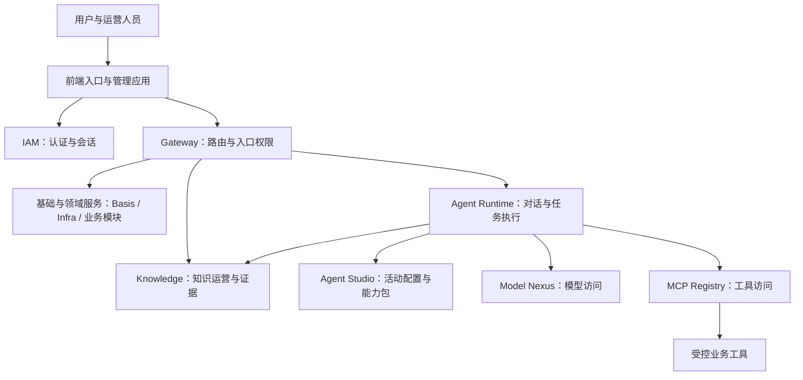
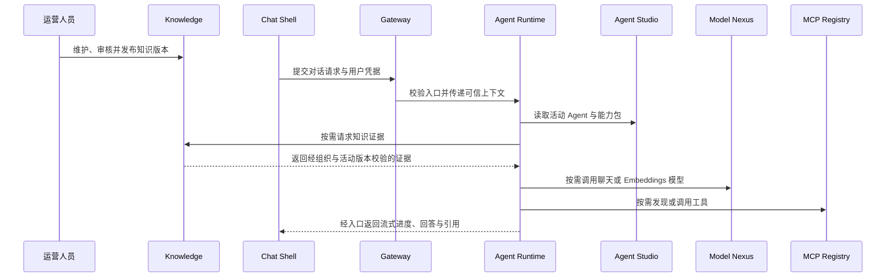

# 平台系统架构：从企业身份到知识与 Agent 执行

本页面向准备部署和二次开发 G2rain 的团队，解释已登记项目之间的职责、数据所有权和集成链路。核对依据为中央[项目目录](catalog/projects.yaml)、[权限模型](../permission-model.md)、[知识与智能体集成](knowledge-integration.md)及各责任仓库的架构概览；这是跨仓导航，不替代各组件版本中的接口、配置和运行说明。中央目录目前登记 34 个项目仓库，涵盖运行组件、共享库、模板、研发与部署工具；[v1.0.0 联合发布](../releases/v1.0.0.md)列出的 23 个业务组件是特定版本的发布范围。

## 四层职责

图中连线表达职责上的协作，不保证每个请求都经过全部组件。Gateway 负责入口校验，业务服务仍需根据可信主体、租户、对象和数据归属作最终裁决。模型提供方、工具服务、数据库和知识处理服务是目标环境中的独立依赖。

| 层 | 代表项目 | 拥有什么 | 不应承担什么 |
| --- | --- | --- | --- |
| 交互与应用承载 | Main/Admin/Chat Shell、Agent App、Knowledge App 等 | 页面、导航、工作区、会话展示和管理操作 | 替代服务端鉴权或拥有知识、任务状态 |
| 身份与平台基础 | Basis、IAM、Gateway、Infra、Department 等 | 组织与权限主数据、登录和 Token、入口校验、基础字典等 | 把 Gateway 的准入视为领域数据授权 |
| 知识与 Agent 领域 | Knowledge、Agent Studio、Agent Runtime、Model Nexus、MCP Registry | 各自的知识状态、Agent 配置、任务执行、模型目录、工具目录 | 跨服务直接修改彼此数据库或复制权威状态 |
| 工程与部署 | Appkit、Common、Starter、模板、CLI、Crafter、Bootstrap、Deploy | 复用契约、工程生成及环境编排 | 充当运行中的业务服务或决定领域规则 |

## 两条相互衔接的业务链路

知识准备从 Knowledge App 的内容维护开始。Knowledge 服务拥有文件与 FAQ、主题和版本、审核发布状态；MySQL 是元数据与活动版本的权威，文件需要持久化存储，Milvus 是可重建的检索投影。解析、Embedding 和可选 Rerank 按环境接入。运营人员发布新版本后，检索请求仍应由 Knowledge 服务按组织和活动版本复核证据，调用方不应绕过该服务读取向量索引或文件。具体状态机与恢复步骤见[知识服务文档](https://github.com/g2rain/g2rain-knowledge)。

Agent 执行从 Chat Shell 的对话入口或其他受信调用方开始。Agent Studio 拥有 Agent 画像、Skill 契约与能力绑定，Runtime 读取活动配置并负责对话、任务图、节点、检查点、恢复和进度事件。Runtime 经 Model Nexus 访问模型，经 MCP Registry 发现与调用工具；需要知识时通过 Knowledge 接口取得证据。Chat Shell 展示回答、引用与执行过程，Agent App 提供配置和追踪的管理界面。工具的业务写入仍须由目标业务服务检查权限与幂等规则。各组件细节见[Agent 六仓发布说明](../releases/agent-core-v2026.11.03.md)。

这是一条用于理解职责的综合路径，不表示每轮对话必定同时调用知识、模型与工具，也不表示演示环境已验证全部分支。接口字段、失败语义与真实调用关系以固定版本的责任项目文档和目标环境联调为准。

## 身份和授权如何贯穿链路

Basis 保存组织、用户、应用授权、角色、控制单元与资源关系；IAM 负责认证、授权码、Token 与会话；Gateway 消费权限事实，校验入口凭据并传递可信主体上下文。Shell 和 App 的菜单或按钮只是交互展示。Knowledge、工具服务及其他领域服务必须继续核对租户、资源、对象状态与数据范围。Agent/Skill 的能力绑定说明“能够尝试什么”，不等于终端用户已获得该业务操作权限。详细对象关系和 USER、MEMBER、Passport 主体差异见[权限模型](../permission-model.md)。

二次开发时，应把可信身份和组织上下文沿服务契约传递，分别验证有权、无权和跨租户请求；不要把浏览器公开配置、微前端 props 或模型提示词当作密钥与授权边界。任务恢复、工具重试和业务写操作还须明确幂等性、审计与失败补偿。

## 部署和扩展的切入点

- 生产方案与快速启动从 [g2rain-bootstrap](https://github.com/g2rain/g2rain-bootstrap) 生成；其默认资源档面向单请求验证，生产容量、凭据、TLS、持久化和备份恢复需按负载重设。开发阶段跨模块联调使用 [g2rain-deploy](https://github.com/g2rain/g2rain-deploy)。
- 先固定[组件发布版本](../releases/v1.0.0.md)与[公共依赖版本](../versions.md)，再按所选项目的部署文档准备 MySQL、Redis、Nacos、知识解析/向量服务、模型和工具接入。部署仓库负责组装，服务仓库负责各自的变量与数据迁移。
- 新建前端应用使用 [App CLI](platform-tools/g2rain-app-cli.md) 与 [Appkit](platform-libraries/g2rain-appkit.md)；新建 Java 服务参考 [Crafter](platform-tools/g2rain-crafter.md) 和适用的 [Java 领域服务 Profile](profiles/java-domain-service/README.md)。生成工程后仍须完成领域设计、权限校验和真实集成测试。
- 最小跨模块验收可从一份测试知识开始：发布内容、以有权用户检索、发起对话、检查引用与执行记录，再以无权及另一租户身份重复请求。还应演练模型不可用、无证据、工具失败、知识回滚和备份恢复。详见[集成验证清单](knowledge-integration.md#集成验证与运行维护)。

本页不声明所有组件在任意环境中已完成全栈生产验收。源码发布、镜像可拉取、演示可访问和目标环境验证是不同事实；逐项结果由对应仓库及部署记录维护。
