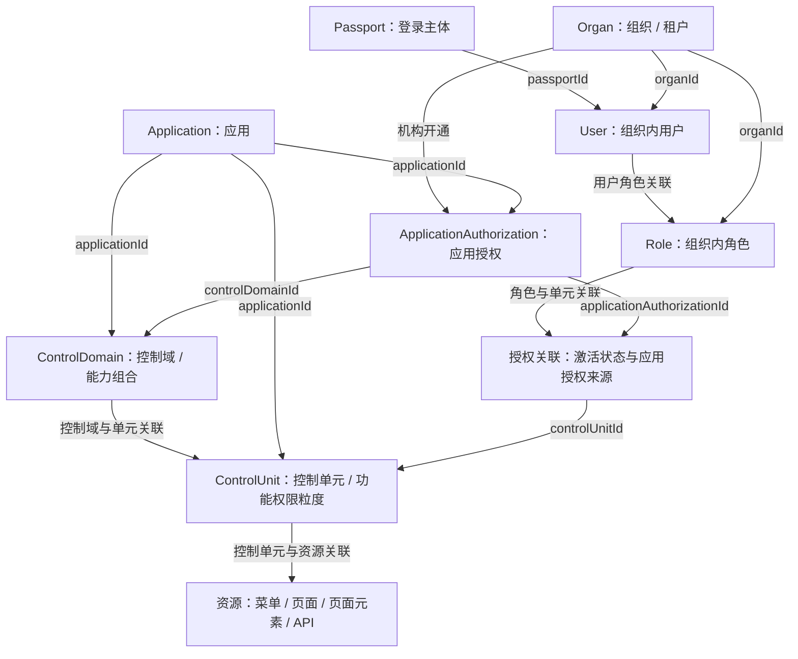
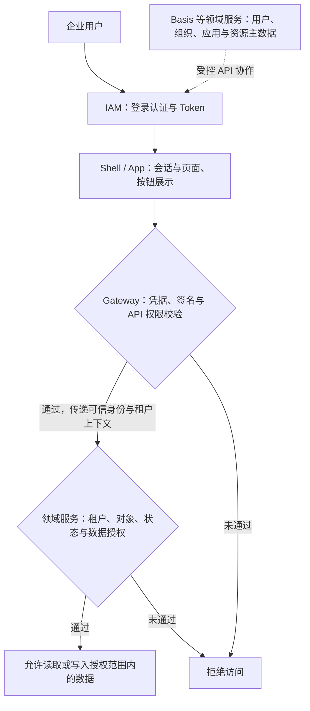

# 权限领域模型与服务分工

谷雨 G2rain 开源 AI Native SaaS 平台以“企业级权限管控 + SaaS Agent 编排”为核心展示定位。本页解释现有权限对象关系与跨服务边界，不定义新 Profile，也不改变项目采用状态。

核对日期：2026-10-19。依据本地 Basis、IAM、WebFlux Gateway 的项目文档和下列实现；未运行应用或跨服务测试。下方领域对象关系图为概念导航，具体字段、约束与变更仍由责任仓库维护。

## 权限领域对象如何关联

**租户开通什么能力，员工获得什么权限，最终能访问哪些资源，分层建模。** 下图依据 Basis 的领域对象与关联字段概括；关系线表示关联，不表示自动授予全部权限。

- **面向 SaaS 交付**：应用组织控制域与控制单元，应用授权记录机构开通的应用及控制域，支持围绕业务能力组织交付范围。
- **面向企业岗位分工**：组织内用户通过角色关联控制单元，再关联具体资源；角色与控制单元的关联同时记录激活状态与应用授权来源。
- **面向不同访问主体**：控制单元还声明会话类型。员工 `USER` 走用户角色链；会员 `MEMBER` 的入口 API 按租户已开通的会员控制单元计算，不把会员伪装成员工角色。

例如，可将“知识审核”组织为控制单元，关联审核页面、按钮和接口，再结合机构开通情况分配给相应岗位。此处是配置场景示意，不表示截图环境已完成该授权配置。

## 权限如何贯穿一次业务请求

例如，知识运营人员能够看到审核入口，并不代表任意审核请求都会被接受：接口仍须通过入口权限校验，知识服务还需核对所属组织、能力点与数据归属。企业可以据此围绕岗位职责设计授权范围，具体角色与资源配置由项目实现和验证。

以上为本仓库已有的架构分工与安全要求；具体项目的落地和联调状态以登记记录为准。详见 [IAM 服务登记](architecture/platform-services/g2rain-iam.md)、[前端资源规则](architecture/profiles/frontend-app/resource-policy.md)、[Gateway 安全边界](architecture/profiles/gateway-service/security-policy.md)与[领域服务安全边界](architecture/profiles/java-domain-service/security-policy.md)。

## 对象关系

| 对象或关联 | 已核对的关系 | 业务含义 |
| --- | --- | --- |
| User | `passportId`、`organId` | 区分登录主体与组织内用户身份 |
| Role、UserRoleRelation | 角色有 `organId`；关联记录 `userId`、`roleId` | 组织内岗位权限分配 |
| ApplicationAuthorization | `organId`、`applicationId`、`controlDomainId`、`status` | 机构对应用及控制域的开通记录 |
| ControlDomain、ControlUnit | 两者均有 `applicationId`，通过专门关联对象连接 | 控制域组合能力，控制单元组织功能权限 |
| RoleControlUnitRelation | `roleId`、`controlUnitId`、`applicationAuthorizationId`、`status` | 岗位获授控制单元，并保留应用授权来源与激活状态 |
| ControlUnitResourceRelation | `controlUnitId`、`resourceId`、`resourceType` | 控制单元关联不同类型资源 |
| 资源 | 菜单、页面、页面元素、API 分别建模 | 页面与按钮用于交互控制，API 权限由网关及服务端校验 |
| ControlUnit.sessionType | 控制单元声明会话类型 | 请求主体类型与功能性质、交付范围是不同维度 |

这是关联关系摘要，不承诺任意配置均有效，也不将表字段存在等同于整个业务闭环完成。例如应用授权记录中的订阅关联字段，不代表订阅计费平台已交付。

## Basis、IAM 与 Gateway 的职责

- **Basis**：维护组织、用户、Passport、应用、资源、角色、控制域和控制单元等权限事实，聚合可访问资源。
- **IAM**：编排身份认证、授权事务与 Token 生命周期。按 `applicationCode` 的登录方式和注册策略由 IAM 配置管理，不属于 Basis 应用开通事实；登录允许与业务接口获权分别判断。
- **Gateway**：校验凭据并根据主体类型消费权限事实。WebFlux 的 `ApiPermissionFilter` 已核对到 Passport、USER、MEMBER 分支；USER 使用组织、用户、角色和应用上下文，MEMBER 使用租户维度的 `MemberPerm`。
- **领域服务**：在入口校验之外继续判断业务对象、租户、状态和数据归属。通过 Gateway 不代表可操作该租户全部数据。

MEMBER 的 Basis 查询核对到“已发布的 MEMBER 控制单元 ∩ 机构已激活应用授权及管理员角色控制单元关联 → API”。管理员角色关联在此承载机构开通事实，不代表会员被加入管理员角色。员工、会员和 Passport 的权限集合不能互相替代。

## 与 SaaS Agent 编排的关系

企业权限回答“谁、以什么组织身份、可以使用哪些能力”；Agent 编排面向“如何组合知识与业务步骤完成任务”。两者结合的价值，是使面向企业的智能应用同时具备能力组合入口与明确的授权边界。

当前中央[知识服务集成设计](architecture/knowledge-service-integration-design.md)已约定 Runtime 请求证据、知识服务核对组织和数据归属等职责。Agent / Skill 绑定不等同于员工角色或租户应用授权；不能据此宣称任意 Agent 工具调用已自动继承终端用户全部权限。具体调用身份、授权传递和失败场景须按真实集成验证。

## 核对依据与状态差异

以下路径位于各自责任仓库，不在中央仓库复制其完整领域设计：

| 仓库 | 文档与实现依据 |
| --- | --- |
| [g2rain-basis](https://github.com/g2rain/g2rain-basis) | `docs/architecture/overview.md`、`docs/design/control-unit-session-type-upgrade.md`；Biz 模块 `dao/po` 下 User、Role、ApplicationAuthorization、ControlDomain、ControlUnit 及关联对象；`service/impl/AuthorityServiceImpl.java`；`resources/mybatis/mapper/ResourceApiMapper.xml` |
| [g2rain-iam](https://github.com/g2rain/g2rain-iam) | `docs/design/application-auth-policy.md`；`src/main/java/com/g2rain/iam/config/AuthPolicyProperties.java` 与 `AuthPolicyEntry.java`；中央 [IAM 登记](architecture/platform-services/g2rain-iam.md) |
| [g2rain-gateway-webflux](https://github.com/g2rain/g2rain-gateway-webflux) | `docs/design/member-api-permission-upgrade.md`；`src/main/java/com/g2rain/gateway/filters/ApiPermissionFilter.java`；`cache/UserPerm.java`、`cache/MemberPerm.java` |

发现的文档差异：Basis 的 SessionType 升级文档仍写 Gateway 消费侧待落地；Gateway 文档已写落地，源码也存在 MEMBER 权限分支。此处按实际读取结果分别记录，不将中央目录的历史测试或接入状态升级为端到端验收通过。公开 GitHub 分支与本地工作区可能不同，上线状态仍需负责人确认。
