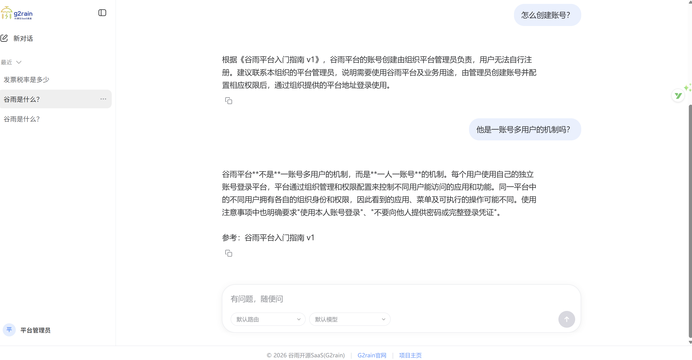
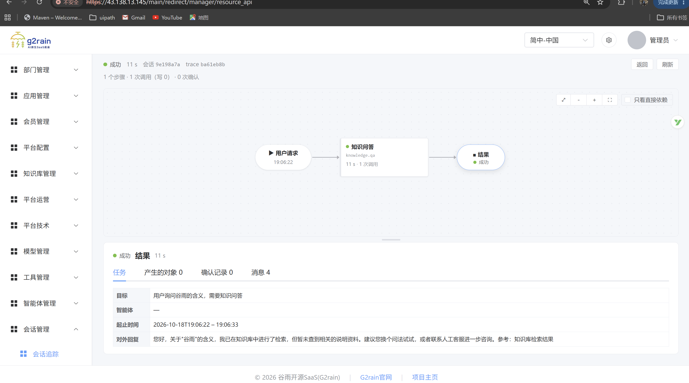
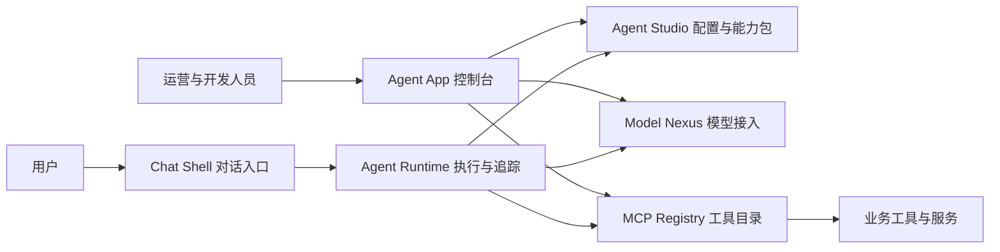

# G2rain Agent 核心六仓发布：让模型连接业务，让任务执行有迹可循

**从一个对话入口，到 Agent 配置、模型接入、工具调用与执行追踪——G2rain（谷雨）开源智能体平台的六个核心仓库现已发布。**

我们希望让 Java 与 Vue 开发者更容易把 Agent 接进已有业务：用熟悉的工程体系管理智能体能力，连接模型与业务工具，并在任务执行后看清发生了什么。

👉 **[立即体验免登录知识对话](https://demo.g2rain.com/chat/?entry=ek_xV3IEOTK8HfexoR3PupYcF)** · **[Star G2rain，收藏项目总入口](https://github.com/g2rain/g2rain)** · **[Follow G2rain 组织，关注后续发布](https://github.com/g2rain)**

## 先看看它能带来什么

你可以从内部手册、产品资料和客服 FAQ 起步，让用户通过对话查找知识；再根据业务需要，为 Agent 配置 Skill、绑定工具，逐步接入查询与办理流程。

当一次请求涉及多个步骤，你需要知道：用了哪个模型、调用了什么工具、任务停在哪里、结果从何而来。G2rain 将配置、执行记录、模型访问和工具接入分别放进明确的模块，便于开发、排障与持续维护。

*知识对话示例：围绕平台入门指南连续提问，并查看回答中的参考资料。*

*执行追踪示例：从用户请求查看处理路径、调用情况与任务详情。两张截图为独立示例。*

## 六个仓库，一条从交互到执行的协作链路

| 仓库 | 你可以用它做什么 |
| --- | --- |
| [g2rain-chat-shell](https://github.com/g2rain/g2rain-chat-shell) | 为用户提供知识对话入口，承载导航、会话协调和微前端应用。 |
| [g2rain-agent-app](https://github.com/g2rain/g2rain-agent-app) | 在运营控制台管理 Agent、Skill、模型与 MCP 工具，查看会话和执行追踪。 |
| [g2rain-agent-studio](https://github.com/g2rain/g2rain-agent-studio) | 维护 Agent 画像、Skill 执行契约及能力绑定，向运行时提供可装载的能力包。 |
| [g2rain-agent-runtime](https://github.com/g2rain/g2rain-agent-runtime) | 协调模型与工具调用，维护任务图、检查点和恢复记录，通过 SSE 返回进度与结果。 |
| [g2rain-model-nexus](https://github.com/g2rain/g2rain-model-nexus) | 统一模型目录、接入资料和用量记录，通过 OpenAI 风格接口路由聊天与 Embeddings 请求。 |
| [g2rain-mcp-registry](https://github.com/g2rain/g2rain-mcp-registry) | 管理工具目录与输入 schema，通过 MCP 提供工具发现、调用代理和必要的主体上下文转发。 |

这张图展示核心职责与协作关系；实际部署还需按项目文档配置身份、网关、数据库及其他平台依赖。

## 为什么值得 Java / Vue 团队关注

**让 Agent 的能力可以管理。** Agent Studio 将画像、Skill 和工具绑定组织为明确的能力资料。你可以为不同角色配置不同能力，再由 Runtime 装载执行。

**让执行过程可以检查。** Runtime 记录任务、节点与工具调用，提供流式进度、检查点和恢复机制，为多步骤任务的排障与后续优化提供依据。涉及业务写入时，仍需结合工具幂等性与目标业务授权配置。

**让模型与工具可以分别演进。** Model Nexus 处理模型协议与访问，MCP Registry 处理工具目录与调用边界。新增模型接入、维护业务工具和调整 Agent 配置，都有对应的责任模块。

**接入企业应用已有的身份与权限体系。** G2rain 的 SaaS 基座提供组织、身份、应用授权与资源权限基础，Agent 可以在这一体系中接入业务。下游服务继续校验用户权限与数据范围，具体链路按目标环境配置和验证。

后端采用 **Java 25、Spring Boot 与 Spring AI**，前端采用 **Vue 3、TypeScript 与 qiankun**。对于已有 Java / Vue 工程经验的团队，可以直接从熟悉的代码和模块边界开始探索。

## 从哪里开始

1. **先体验交互**：[打开知识对话演示](https://demo.g2rain.com/chat/?entry=ek_xV3IEOTK8HfexoR3PupYcF)，无需登录；试着围绕同一份资料连续提问。
2. **再选一个切入点**：关注执行机制，从 Runtime 开始；关注业务工具接入，从 MCP Registry 开始；关注产品界面，从 Chat Shell 与 Agent App 开始。
3. **部署自己的环境**：阅读[开发与部署入口](https://github.com/g2rain/g2rain/blob/main/docs/getting-started.md)和[部署仓库](https://github.com/g2rain/g2rain-deploy)，按各仓库的版本说明准备配置、模型与服务依赖。

六个核心仓库已发布，本次是平台级联合介绍，各组件的版本、镜像和运行要求请查看对应仓库的发布与部署文档。知识库通过独立的 [g2rain-knowledge](https://github.com/g2rain/g2rain-knowledge) 与运营端提供；本文演示使用了知识能力。源码按各仓库随附的 Apache-2.0 许可证开放，生产接入需完成业务工具、权限和目标环境的联调。

## 邀请你成为早期参与者

如果你正在寻找 Java / Vue 技术栈的企业 Agent 平台，欢迎亲自跑一跑，也欢迎挑一个真实业务问题来讨论。

- **[给主仓库一个 Star](https://github.com/g2rain/g2rain)**：收藏六个核心项目、平台文档与后续版本的统一入口。
- **[进入 G2rain 组织主页，点击 Follow](https://github.com/g2rain)**：关注六个仓库及其他平台模块的更新。
- **[在 Discussions 分享你的场景](https://github.com/g2rain/g2rain/discussions)**：告诉我们，你希望 Agent 优先接入哪项业务？知识客服、内部助手，还是已有系统的查询与办理？
- **[提交使用反馈](https://github.com/g2rain/g2rain/issues)**：一次复现清楚的问题、一处文档修正或一个接入示例，都能帮助下一位开发者更快上手。

**欢迎一起把 Agent 带进真实业务。**

[官方网站](https://www.g2rain.com) · [平台文档](https://github.com/g2rain/g2rain/blob/main/docs/index.md) · [界面展示](https://github.com/g2rain/g2rain/blob/main/docs/showcase.md)
