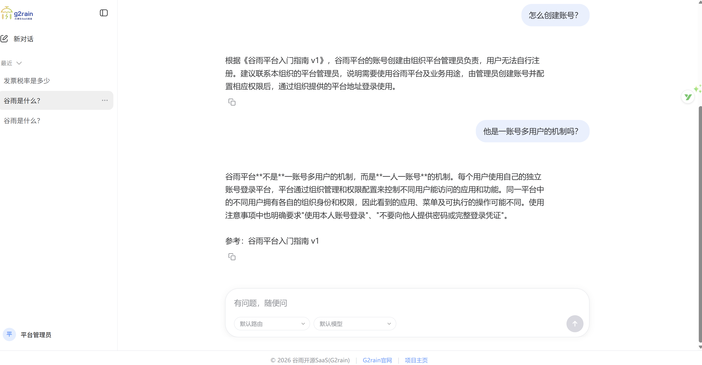
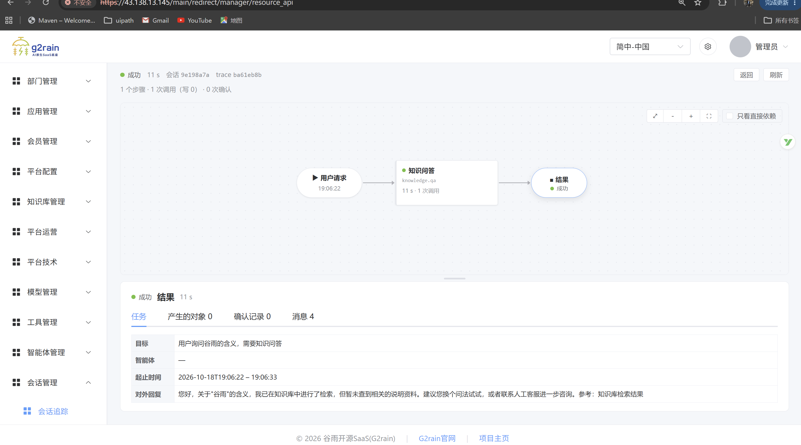

# G2rain v1.0.0：企业 Agent、知识库与 SaaS 业务组件联合发布

**G2rain（谷雨）开源智能体平台 v1.0.0 发布。本次汇集 23 个业务组件，覆盖企业身份与权限、知识运营与问答、Agent 配置与执行、模型与工具接入，以及配套的主应用和业务管理界面。**

从准备一份业务知识，到配置一个 Agent、接入业务工具，再到查看执行过程，开发者现在可以沿着完整的模块分工构建自己的智能应用。现有业务模块均已开发完成并发布，欢迎 Java / Vue 团队体验、部署和参与建设。

**[立即体验免登录知识对话](https://demo.g2rain.com/chat/?entry=ek_xV3IEOTK8HfexoR3PupYcF) · [Star 项目总入口](https://github.com/g2rain/g2rain) · [Follow G2rain 组织](https://github.com/g2rain)**

## 本次发布带来什么

### 企业 Agent：从对话到可追踪的任务执行

Chat Shell 提供面向用户的对话入口，Agent App 提供运营和观测界面；Agent Studio 管理画像、Skill 执行契约及工具绑定，Runtime 装载这些能力并组织模型与工具调用。

Runtime 维护任务图、节点、检查点、恢复记录与工具调用记录，通过 SSE 持续返回进度和结果。开发者可以围绕一次请求观察处理路径，为排障与迭代提供依据。

Model Nexus 统一模型接入资料和用量记录，将 OpenAI 风格的聊天、Embeddings 请求路由到 OpenAI、Anthropic 或 Google GenAI 客户端。MCP Registry 管理服务与工具目录、解析输入 schema，提供工具发现与调用代理。

### 知识库：让业务资料成为可以维护和引用的知识

知识服务与运营端支持文件、FAQ、分类标签、主题及版本管理，将内容提交、审核、处理、发布与回滚组织成运营流程。检索接口返回经过组织与活动版本校验的证据，回答接口基于证据组织回复。

MySQL 维护知识元数据与发布状态，Milvus 承载检索投影；文档处理、Embedding 与可选 Rerank 按部署环境配置。团队可以从内部操作手册、产品资料和客服知识开始建设。

*截图为独立交互示例，展示知识参考与任务追踪界面。*

### SaaS 基座：组织、身份、权限与业务扩展

Basis 维护组织、身份主数据、应用资源与权限关系；IAM 提供统一认证和 Token；WebFlux 与 WebMVC 两种 Gateway 实现提供入口路由、凭据校验、API 权限与可信主体透传。

Department 提供部门、成员归属及数据权限策略控制面，Member 提供会员主数据与外部身份绑定，CMS 提供站点、空间、栏目、页面与文章管理。Infra 提供字典、国际化、区域和分布式 ID 等公共基础能力。

这些服务配套管理前端，由 Main Shell、Admin Shell 承载导航、工作区与微前端运行。业务服务根据可信身份继续执行对象、租户和数据范围授权。

## v1.0.0 组件清单

以下列出本次联合发布的 **23 个业务组件 v1.0.0**，每个链接指向对应版本的发布说明。

| 模块 | 版本 | 交付范围与版本说明 |
| --- | --- | --- |
| [g2rain-basis](https://github.com/g2rain/g2rain-basis) | 1.0.0 | [组织、身份主数据、应用资源和权限关系](https://github.com/g2rain/g2rain-basis/blob/v1.0.0/docs/releases/v1.0.0.md) |
| [g2rain-iam](https://github.com/g2rain/g2rain-iam) | 1.0.0 | [统一认证、登录与 Token](https://github.com/g2rain/g2rain-iam/blob/v1.0.0/docs/releases/v1.0.0.md) |
| [g2rain-infra](https://github.com/g2rain/g2rain-infra) | 1.0.0 | [字典、国际化、区域、路由及分布式 ID](https://github.com/g2rain/g2rain-infra/blob/v1.0.0/docs/releases/v1.0.0.md) |
| [g2rain-gateway-webflux](https://github.com/g2rain/g2rain-gateway-webflux) | 1.0.0 | [响应式入口路由与安全校验](https://github.com/g2rain/g2rain-gateway-webflux/blob/v1.0.0/docs/releases/v1.0.0.md) |
| [g2rain-gateway-webmvc](https://github.com/g2rain/g2rain-gateway-webmvc) | 1.0.0 | [Servlet 入口路由与安全校验](https://github.com/g2rain/g2rain-gateway-webmvc/blob/v1.0.0/docs/releases/v1.0.0.md) |
| [g2rain-department](https://github.com/g2rain/g2rain-department) | 1.0.0 | [部门、成员归属及数据权限控制面](https://github.com/g2rain/g2rain-department/blob/v1.0.0/docs/releases/v1.0.0.md) |
| [g2rain-member](https://github.com/g2rain/g2rain-member) | 1.0.0 | [会员主数据与外部身份绑定](https://github.com/g2rain/g2rain-member/blob/v1.0.0/docs/releases/v1.0.0.md) |
| [g2rain-cms](https://github.com/g2rain/g2rain-cms) | 1.0.0 | [站点、空间、栏目、页面与文章](https://github.com/g2rain/g2rain-cms/blob/v1.0.0/docs/releases/v1.0.0.md) |
| [g2rain-main-shell](https://github.com/g2rain/g2rain-main-shell) | 1.0.0 | [平台主壳与应用承载](https://github.com/g2rain/g2rain-main-shell/blob/v1.0.0/docs/releases/v1.0.0.md) |
| [g2rain-admin-shell](https://github.com/g2rain/g2rain-admin-shell) | 1.0.0 | [管理主壳与工作区](https://github.com/g2rain/g2rain-admin-shell/blob/v1.0.0/docs/releases/v1.0.0.md) |
| [g2rain-manager-app](https://github.com/g2rain/g2rain-manager-app) | 1.0.0 | [账号、组织、权限与应用管理界面](https://github.com/g2rain/g2rain-manager-app/blob/v1.0.0/docs/releases/v1.0.0.md) |
| [g2rain-infra-app](https://github.com/g2rain/g2rain-infra-app) | 1.0.0 | [基础设施管理界面](https://github.com/g2rain/g2rain-infra-app/blob/v1.0.0/docs/releases/v1.0.0.md) |
| [g2rain-department-app](https://github.com/g2rain/g2rain-department-app) | 1.0.0 | [部门与数据权限配置界面](https://github.com/g2rain/g2rain-department-app/blob/v1.0.0/docs/releases/v1.0.0.md) |
| [g2rain-member-app](https://github.com/g2rain/g2rain-member-app) | 1.0.0 | [会员业务前端接入](https://github.com/g2rain/g2rain-member-app/blob/v1.0.0/docs/releases/v1.0.0.md) |
| [g2rain-cms-app](https://github.com/g2rain/g2rain-cms-app) | 1.0.0 | [CMS 内容管理界面](https://github.com/g2rain/g2rain-cms-app/blob/v1.0.0/docs/releases/v1.0.0.md) |
| [g2rain-knowledge-app](https://github.com/g2rain/g2rain-knowledge-app) | 1.0.0 | [知识内容、审核、发布与运营](https://github.com/g2rain/g2rain-knowledge-app/blob/v1.0.0/docs/releases/v1.0.0.md) |
| [g2rain-chat-shell](https://github.com/g2rain/g2rain-chat-shell) | 1.0.0 | [知识对话、会话与执行时间线](https://github.com/g2rain/g2rain-chat-shell/blob/v1.0.0/docs/releases/v1.0.0.md) |
| [g2rain-agent-app](https://github.com/g2rain/g2rain-agent-app) | 1.0.0 | [Agent、模型、工具与任务追踪控制台](https://github.com/g2rain/g2rain-agent-app/blob/v1.0.0/docs/releases/v1.0.0.md) |
| [g2rain-agent-runtime](https://github.com/g2rain/g2rain-agent-runtime) | 1.0.0 | [任务图、工具编排、检查点、恢复与 SSE](https://github.com/g2rain/g2rain-agent-runtime/blob/v1.0.0/docs/releases/v1.0.0.md) |
| [g2rain-agent-studio](https://github.com/g2rain/g2rain-agent-studio) | 1.0.0 | [Agent 画像、Skill 契约与能力绑定](https://github.com/g2rain/g2rain-agent-studio/blob/v1.0.0/docs/releases/v1.0.0.md) |
| [g2rain-model-nexus](https://github.com/g2rain/g2rain-model-nexus) | 1.0.0 | [模型目录、协议路由、聊天与 Embeddings](https://github.com/g2rain/g2rain-model-nexus/blob/v1.0.0/docs/releases/v1.0.0.md) |
| [g2rain-mcp-registry](https://github.com/g2rain/g2rain-mcp-registry) | 1.0.0 | [MCP 工具目录、schema 与调用代理](https://github.com/g2rain/g2rain-mcp-registry/blob/v1.0.0/docs/releases/v1.0.0.md) |
| [g2rain-knowledge](https://github.com/g2rain/g2rain-knowledge) | 1.0.0 | [知识库服务与镜像交付](https://github.com/g2rain/g2rain-knowledge/blob/v1.0.0/docs/releases/v1.0.0.md) |
| 你想了解什么 | 推荐阅读 |
| --- | --- |
| 平台是什么，为什么值得关注 | [平台首页](../../README.md) → [平台概览](../overview.md) |
| 撰写项目介绍或让 AI 准确引用 | [项目介绍与引用资料](../project-introduction.md) · [AI 阅读索引](../../llms.txt) |
| 企业权限怎样建模与校验 | [权限模型与完整说明图](../permission-model.md) |
| 体验知识对话和平台主应用 | [在线演示与登录说明](../roadmap.md#在线演示) |
| 知识与 Agent 的界面和业务场景 | [三张界面展示](../showcase.md) → [知识与 Agent 导览](../overview.md#知识库) |
| 安装哪个 Maven / npm 版本，如何配套 | [版本与依赖](../versions.md) |
| 如何动手开发或部署 | [开始探索与开发](../getting-started.md) |
| 已发布什么，接下来做什么，如何判断完成 | [平台路线图](../roadmap.md) → [项目架构目录](../architecture/catalog/projects.yaml) |
| 与其他开源项目如何选型 | [RuoYi、Dify、RAGFlow 对比](../comparison.md) |
| 已开放模块采用什么协议 | [开源协议说明](../licenses.md) |
| 如何参与 | [贡献指南](../../community/CONTRIBUTING.md) → [社区与治理](#社区与治理) |
| 查看前端开发工具发布 | [2026-10-29：Appkit、App CLI 与两个模板 v1.0.1](ecosystem-v2026.10.29.md) |
| 资料 | 用途与维护边界 |

知识服务统一使用 v1.0.0，详见 [v1.0.0 发布说明](https://github.com/g2rain/g2rain-knowledge/blob/main/docs/releases/v1.0.0.md)。

## 技术与版本配套

- **后端业务服务**：Java 25、Spring Boot、Spring Cloud；Agent 与模型相关服务使用 Spring AI。具体框架与依赖版本以组件标签内的 POM 为准。
- **前端业务应用**：Vue 3、TypeScript、Vite、qiankun；构建通常要求 Node.js 22+，运行镜像使用 OpenResty。
- **前端研发配套**：App CLI、App Template 与 Shell Template v1.0.2，Appkit 公共包 v1.0.1。
- **后端研发配套**：Common v1.0.9、MyBatis Extensions v1.0.5、Starter v1.0.6、Generator v1.0.8、Crafter v1.0.9；按组件依赖选择，详见[版本与依赖](https://github.com/g2rain/g2rain/blob/main/docs/versions.md)。

平台联合发布版本、各组件版本和研发工具版本独立维护；业务组件 v1.0.0 不要求工具链也使用同名版本。

## 体验与部署

1. **先体验**：[知识对话演示](https://demo.g2rain.com/chat/?entry=ek_xV3IEOTK8HfexoR3PupYcF)无需登录；也可查看[产品界面与场景](https://github.com/g2rain/g2rain/blob/main/docs/showcase.md)。
2. **选择需要的组件**：知识问答从知识服务、知识运营端和 Chat Shell 开始；Agent 业务接入从六个 Agent 核心仓库开始；已有业务系统可先了解身份、Gateway 与资源权限。
3. **准备自己的环境**：从 [g2rain-bootstrap](https://github.com/g2rain/g2rain-bootstrap) 与[开发部署入口](https://github.com/g2rain/g2rain/blob/main/docs/getting-started.md)进入，按所选组件配置 MySQL、Redis、Nacos、网关、模型供应商及必要的知识处理服务。
4. **固定版本并联调**：使用组件版本标签与发布说明，准备数据库、模型凭据、可信工具和业务权限，验证登录、知识检索、工具调用与执行结果。

业务服务和前端主要通过 GHCR 镜像交付，常用地址形式为 `ghcr.io/g2rain/<仓库名>:1.0.0`；部分领域 API 另提供 GitHub Maven Packages 制品。具体可用渠道、访问权限、端口、持久化目录与运行参数按各仓库说明执行。知识服务统一使用 v1.0.0，具体交付内容见该版本发布说明。

主仓库的 Source code 下载包含平台文档与治理资料。应用实现、镜像和配置入口位于上表各组件仓库。

## 发布范围与后续方向

本次发布覆盖现有业务组件、Agent 核心模块与知识库。交易、支付、订阅、计量计费和账单等云端商业运营能力继续按[路线图](https://github.com/g2rain/g2rain/blob/main/docs/roadmap.md)建设。

各组件发布说明保留其构建、测试、运行依赖及已知限制。实际部署需结合所选版本完成环境配置与业务联调；任务恢复、权限策略和工具写操作应按目标场景验证。组件发布阶段与架构固定快照分别维护。

## 一起把 Agent 带进真实业务

如果你希望用 Java / Vue 构建企业智能应用，欢迎从一个具体场景开始：一份内部手册、一个客服知识库，或者一项已有业务查询工具。

- **[Star g2rain/g2rain](https://github.com/g2rain/g2rain)**：收藏平台、组件与版本的统一入口。
- **[Follow G2rain 组织](https://github.com/g2rain)**：关注各模块更新与后续发布。
- **[在 Discussions 分享场景](https://github.com/g2rain/g2rain/discussions)**：告诉我们你希望 Agent 接入哪项业务。
- **[提交 Issue](https://github.com/g2rain/g2rain/issues)**：附上组件、版本、环境和复现步骤，帮助完善使用体验。

### 如何提交代码贡献

欢迎从修复一个 Bug、补充一个测试、完善部署说明或提供业务工具接入示例开始。较大的新功能或跨组件调整，请先通过 Issue / Discussions 讨论方案与影响范围。

1. **选择目标仓库并 Fork**：业务代码提交到对应组件仓库，平台介绍与治理文档提交到 `g2rain/g2rain`。
2. **从上游最新 `develop` 创建工作分支**：例如 `feature/xxx`、`fix/issue-123` 或 `docs/xxx`，一个 PR 聚焦一个问题。
3. **实现并验证**：先阅读目标仓库的 README、AGENTS.md 和相关文档，执行该仓库要求的构建、测试与检查；同步接口、配置或部署说明。
4. **推送分支并创建 PR**：目标选择 **上游仓库的 `develop`**，来源选择你的 Fork 工作分支。描述问题、改动、关联 Issue、实际验证结果，以及配置、数据库或跨组件兼容性影响；界面改动可附截图。
5. **配合 Review**：根据反馈在原分支继续提交，必要时同步上游 `develop`、解决冲突并重新验证。未完成的工作可先创建 Draft PR。
6. **由维护者验证并进入稳定分支**：PR 合入 `develop` 后，我们完成测试环境验证和必要的联调，再合并进入 `main`，按发布计划创建版本标签。

**统一流程：工作分支 → PR 到 `develop` → Review → 维护者验证 → 合并 `main` → 发布。**

PR 请提供可复现的问题说明和真实验证结果，避免混入无关修改、本地配置、凭据或构建产物。完整操作示例见[贡献指南](https://github.com/g2rain/g2rain/blob/main/community/CONTRIBUTING.md)。

感谢所有参与代码、文档、测试与场景反馈的开发者。各组件采用随附的 Apache-2.0 许可证，第三方依赖遵循各自条款。

[官方网站](https://www.g2rain.com) · [平台文档](https://github.com/g2rain/g2rain/blob/main/docs/index.md) · [开源协议说明](https://github.com/g2rain/g2rain/blob/main/docs/licenses.md)
