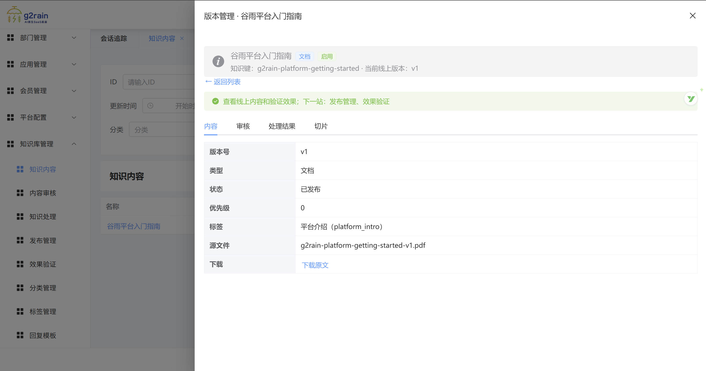
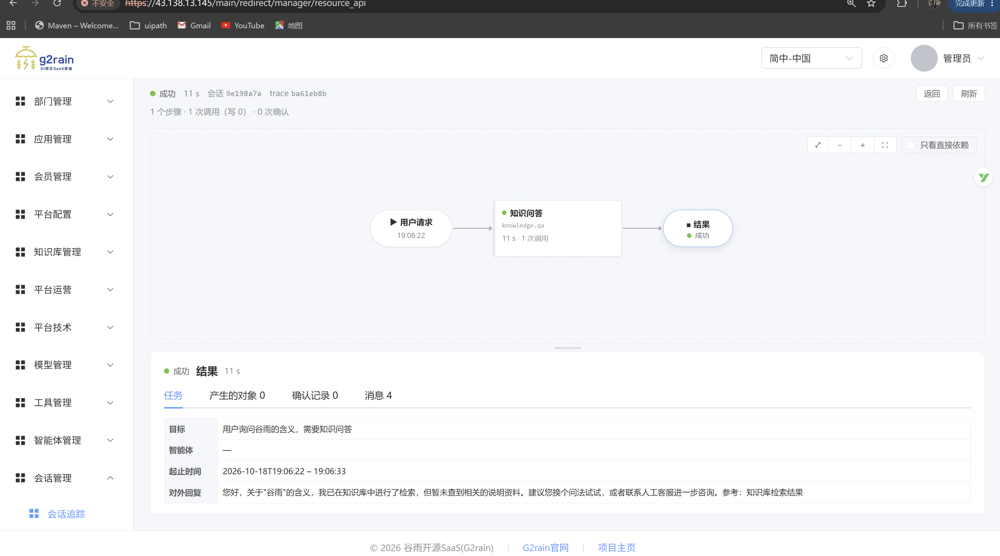

# 产品界面与场景展示

**让业务知识进入对话，让处理过程有迹可循。** 从入门指南、内部操作手册到客服知识，下面的界面展示了G2rain（谷雨）开源智能体平台的知识管理、对话问答与执行追踪场景。

### 用自然语言，找到业务问题的答案

用户围绕账号创建、账号使用方式连续提问，回答中显示《谷雨平台入门指南 v1》作为参考，方便进一步核对知识来源。

查看知识管理：把业务文档整理成可维护的知识版本

版本管理界面集中展示版本号、发布状态、标签与源文件，并提供内容、审核、处理结果和切片入口。业务人员可以围绕同一份知识查看内容与发布信息。

查看执行追踪：从用户请求到知识问答结果

执行视图展示“用户请求 → 知识问答 → 结果”的路径，以及耗时、调用次数和任务详情。这张示例也保留了未找到相关资料时的回复，便于了解无匹配知识时的反馈方式。

以上为项目维护者提供的界面截图，展示可见交互；各图为独立示例，不代表同一次请求或全部场景的验收结果。架构与验收要求见[集成设计](architecture/knowledge-service-integration-design.md)。

**想了解你的业务场景如何接入？** 欢迎通过[项目邮箱](mailto:g2rain_developer@163.com)交流，或在 [Discussions](https://github.com/g2rain/g2rain/discussions)分享需求。也可以先[探索知识库](overview.md#知识库)与[Agent 能力](overview.md#agent-能力)。

[返回组织首页](../README.md) · [查看权限模型](permission-model.md) · [阅读项目进展](roadmap.md)
